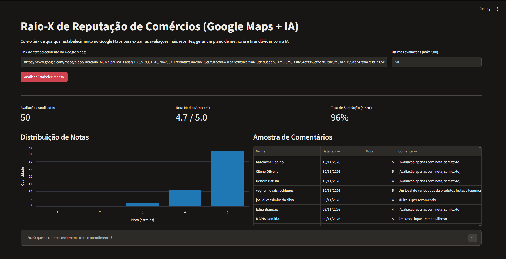
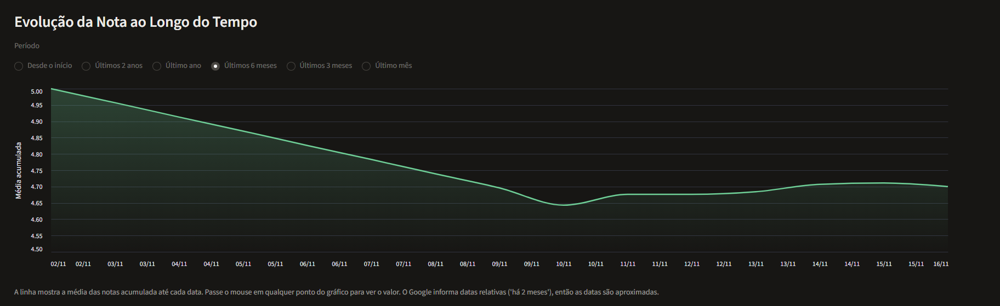
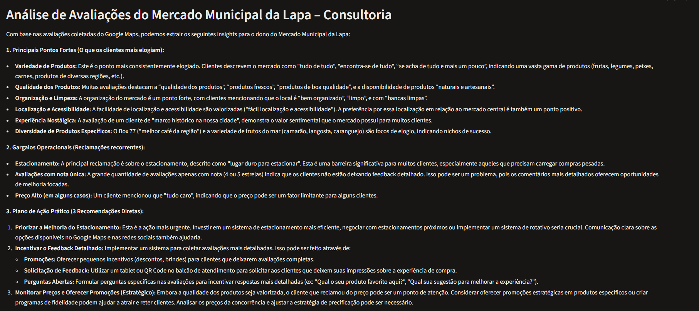

# Raio-X de Reputação de Comércios (Google Maps + IA)

Donos de comércio recebem dezenas ou centenas de avaliações e quase nunca têm tempo de ler todas. Esta ferramenta coleta as avaliações mais recentes de qualquer estabelecimento do Google Maps, transforma em indicadores e gráficos, gera um plano de ação com IA e permite **conversar com a IA sobre os dados reais do negócio**. Tudo roda localmente, sem enviar dados para serviços pagos.

**Palavras-chave:** IA generativa · LLM · prompt engineering · análise de dados com IA · dashboard · automação de coleta · Python · Streamlit · Ollama · vibe coding

## Demo

Exemplo real: **Mercado Municipal da Lapa (São Paulo)**, nota 4,4 e mais de 40 mil avaliações no Google Maps.

**1. Local analisado no Google Maps**

**2. Dashboard: indicadores, distribuição de notas e amostra de comentários**

**3. Evolução da nota média ao longo do tempo, com filtro de período**

**4. Análise gerada pela IA: pontos fortes, gargalos e sugestões de melhoria**

**5. Chat: o dono pergunta e a IA responde com base nas avaliações reais**

## Como usar (Windows)

1. Instale o [Python](https://www.python.org/downloads/) (marque **Add Python to PATH**) e o [Ollama](https://ollama.com/download)
2. Baixe este projeto (**Code → Download ZIP**) e extraia
3. Dê dois cliques em **`iniciar.bat`**

Na primeira vez, ele instala as dependências, baixa o modelo de IA e abre o Edge para você entrar na sua conta Google (depois é só fechar a janela). Nas próximas vezes, abre direto.

Depois, cole o link de um local do Google Maps (abra o estabelecimento e copie o link, ou use **Compartilhar**), escolha quantas avaliações coletar (até 500) e clique em **Analisar Estabelecimento**.

## Funcionalidades

- Coleta automatizada das avaliações mais recentes (até 500): nome, data aproximada, nota e comentário
- Indicadores: nota média, taxa de satisfação e distribuição de notas
- Gráfico de evolução da nota ao longo do tempo, com hover contínuo e filtro de período (do início até o último mês)
- Diagnóstico por IA: pontos fortes, gargalos operacionais e plano de ação
- **Chat com IA sobre as avaliações**: perguntas livres ou sugeridas, respostas em streaming e com memória da conversa, baseadas apenas nos dados coletados
- Exportação para Excel formatado, com aba do diagnóstico

## Como foi construído

- **Coleta:** automação com Selenium e perfil de navegador persistente (login manual uma única vez)
- **IA generativa:** LLM local via Ollama (`gemma3:4b`), com prompt engineering estruturado: papel definido, dados no contexto e instrução para responder só com base nas avaliações, sem inventar
- **Análise de dados:** Pandas e Altair
- **Interface:** dashboard em Streamlit
- **Desenvolvimento:** projeto construído com apoio de IA (vibe coding e prompt engineering), do protótipo ao produto em poucos dias

## Tecnologias

Python, Streamlit, Selenium, Pandas, Altair, Ollama, XlsxWriter

## Limitações

- Requer Windows e Microsoft Edge. Use de preferência uma conta Google secundária
- As datas são aproximadas, pois o Google informa tempo relativo ("há 2 meses")
- O scraping depende do HTML do Google Maps e pode precisar de ajustes se ele mudar
- A IA analisa as 150 avaliações mais recentes; gráficos e Excel usam todas as coletadas
- A qualidade das respostas depende do modelo local usado

## Próximos passos

- Automação de alertas para avaliações negativas
- API para integrar o diagnóstico a outros sistemas

## Aviso

Projeto educacional e de portfólio. O scraping pode violar os termos de uso do Google. Para uso comercial, prefira APIs oficiais.