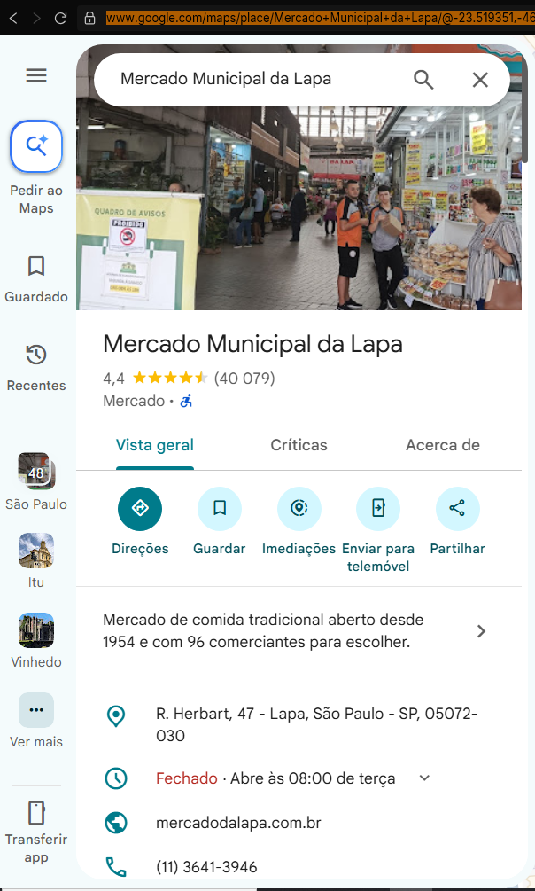
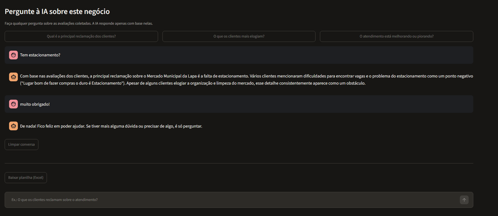

## Demo

Exemplo real: **Mercado Municipal da Lapa (São Paulo)**, nota 4,4 e mais de 40 mil avaliações no Google Maps.

**1. Local analisado no Google Maps**

**2. Dashboard: indicadores, distribuição de notas e amostra de comentários**

**3. Evolução da nota média ao longo do tempo, com filtro de período**

**4. Análise gerada pela IA: pontos fortes, gargalos e sugestões de melhoria**

**5. Chat: o dono pergunta e a IA responde com base nas avaliações reais**

